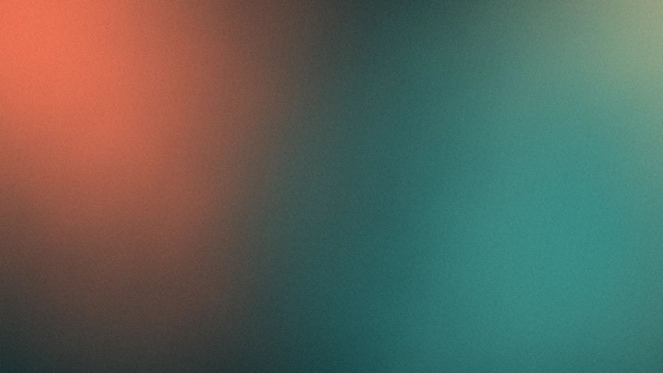
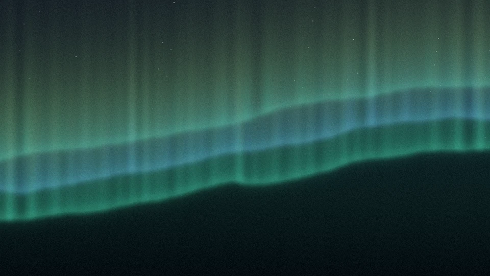
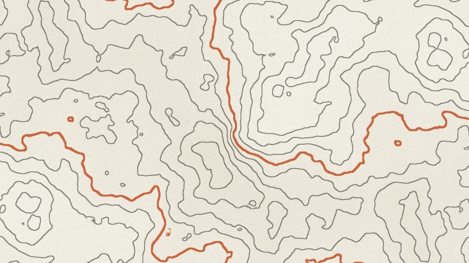
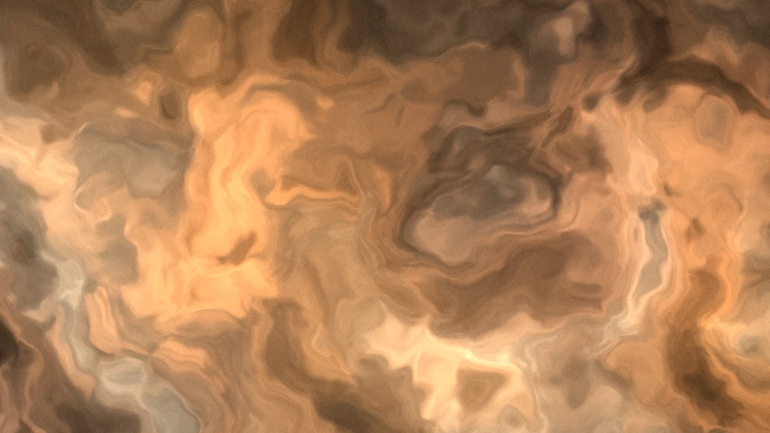
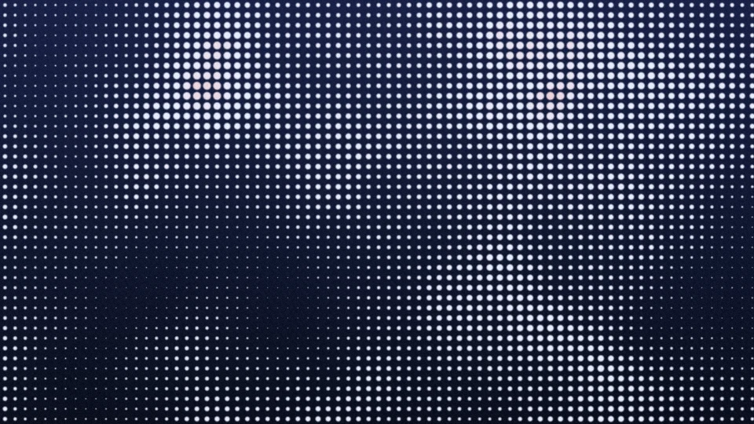
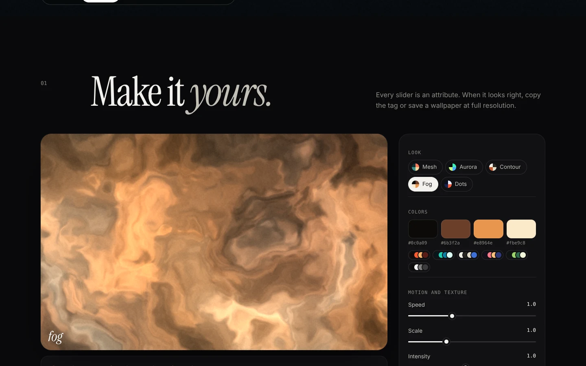

# latar

[](https://github.com/rezaaryam/latar/actions/workflows/test.yml)


Living WebGL backgrounds in one tag. Five looks, any four colors, about 8 KB, and a CSS fallback for the rare browser without WebGL. It pauses itself whenever nobody is watching.

*Latar* is Indonesian for background.

**[Open the demo and playground](https://rezaaryam.github.io/latar/)**


```html
<script src="https://rezaaryam.github.io/latar/latar.js"></script>

<section style="position: relative">
  <latar-bg preset="aurora" interactive></latar-bg>
  <h1 style="position: relative">Hello</h1>
</section>
```

## Five looks

| | |
|---|---|
|  **mesh**: soft color fields drifting into each other |  **aurora**: curtains of light over a night sky |
|  **contour**: a topographic map that slowly reshapes itself |  **fog**: warped smoke, folding over and over |
|  **dots**: a field of dots that swells like a tide |  **the playground**: tune every option, copy the tag, or save a wallpaper |

These pictures were saved with `snapshot()`, the same call the playground uses for wallpapers.

## Options

Every option works as an attribute on `<latar-bg>` and as a key for `Latar.mount()`.

| Option | Default | What it does |
|---|---|---|
| `preset` | `mesh` | `mesh`, `aurora`, `contour`, `fog`, or `dots` |
| `colors` | per preset | Four colors, separated by spaces or commas. Hex or `rgb()`. The first is the base. |
| `speed` | `1` | `0` freezes time, `4` is fast |
| `scale` | `1` | Zoom of the pattern, `0.25` to `4` |
| `intensity` | `1` | How strong the effect is against the base color |
| `grain` | `0.045` | Film grain on top, hides banding on cheap screens |
| `interactive` | off | The pattern bends toward the pointer |
| `resolution` | per preset | Render scale. Soft looks render at half size and nobody can tell. |
| `paused` | off | Draw one frame and stop |
| `seed` | `0` | Starting point in time, so two backgrounds with the same preset do not look identical |

The element fills its nearest positioned parent (`position: absolute; inset: 0`) and ignores the pointer, so it never blocks clicks.

## JavaScript

```js
const bg = Latar.mount(document.querySelector(".hero"), { preset: "fog", interactive: true });

bg.set({ colors: ["#0c0a09", "#6b3f2a", "#e8964e", "#fbe9c8"], speed: 0.6 });
bg.pause();
bg.play();

const png = await bg.snapshot(3840, 2160); // a Blob at any size
bg.destroy();
```

On the element, the same controller lives at `element.latar`, and a `latar-ready` event fires with `detail.webgl` telling you whether WebGL is in use.

## Polite by default

- **Stops when it is not seen.** An IntersectionObserver pauses drawing when the element leaves the screen, and drawing also stops while the tab is hidden.
- **Holds still on request.** With `prefers-reduced-motion`, it draws one frame and waits.
- **Watches its budget.** Device pixel ratio is capped at 2, soft looks render at a lower resolution, and no canvas grows past 2.4 million pixels.
- **Never leaves a blank box.** If WebGL is missing or a shader fails, the element shows a CSS gradient built from the same colors. A lost WebGL context is restored automatically.

## How it works

Each look is a single fragment shader drawn on one full-screen triangle. They share a small toolkit: gradient noise, fractal Brownian motion, and film grain. `mesh` warps the plane and blends three moving color fields; `aurora` stacks three wavy curtains with ray noise and an exposure curve; `contour` draws iso-lines of a noise field with `fwidth()` anti-aliasing and thicker index lines every fifth step; `fog` is domain-warped noise; `dots` is a halftone grid whose dots grow with a moving noise field and a ripple around the pointer.

## Development

```bash
npm install
npx playwright install chromium   # once
npm test                          # 19 tests: options, fallbacks, and every shader in real WebGL
npm start                         # the docs site at http://localhost:3000
npm run sync                      # copy src/latar.js into docs/ after changes
```

The browser tests run in headless Chromium with software WebGL. They check that every shader compiles and draws a picture that is not flat, that animation stops off screen and with reduced motion, that the CSS fallback appears when WebGL is missing, and that `snapshot()` returns a PNG of the requested size.

## License

Code: MIT © Reza Arya Maulana. Fonts in `docs/fonts/` (Instrument Serif, Inter) are under the SIL Open Font License.
